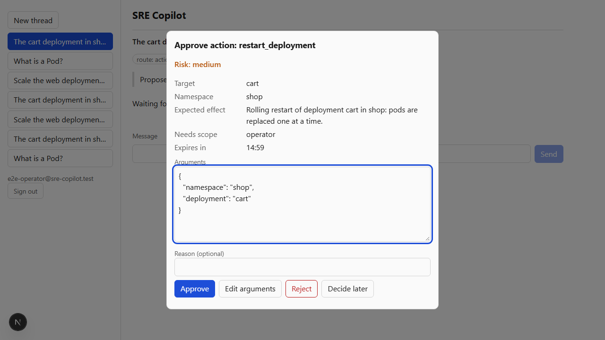

# SRE Copilot

A production-style RAG + MCP agent for Kubernetes operations, built solo on a $0 budget.
It answers Kubernetes and cloud-native questions from versioned docs with citations, and (from
Phase 3) acts on a cluster through an MCP server: inspect resources, restart or scale workloads
after approval, open incidents.

**The rule:** a technique stays only if it beats the baseline on quality, latency or cost.
Every number below comes from an eval run stamped with the git SHA, config hash, embedding
model, corpus version and golden-set version that produced it. Experiments that lose are written
up as negative results.

## Results

<!-- results:start -->
| Experiment | Model | recall@5 | MRR@10 | nDCG@10 | p95 ms | Items | Golden | Git SHA |
|---|---|---|---|---|---|---|---|---|
| `dense-bge-large` | bge-large | 0.870 | 0.670 | 0.722 | 58 | 69 | v1-cb87f3bc | `82e4565f5b06` |
| `dense-bge-m3` | bge-m3 | 0.870 | 0.675 | 0.737 | 88 | 69 | v1-cb87f3bc | `82e4565f5b06` |
| `dense-gte-small` | gte-small | 0.855 | 0.644 | 0.705 | 47 | 69 | v1-cb87f3bc | `bc3725da27b2` |
| `hybrid-bge-large` | bge-large | 0.652 | 0.528 | 0.586 | 320 | 69 | v1-cb87f3bc | `82e4565f5b06` |
| `hybrid-bge-m3` | bge-m3 | 0.681 | 0.577 | 0.625 | 368 | 69 | v1-cb87f3bc | `82e4565f5b06` |
| `hybrid-gte-small` | gte-small | 0.638 | 0.491 | 0.551 | 313 | 69 | v1-cb87f3bc | `bc3725da27b2` |
| `hybrid-gte-small-wk0p5` | gte-small | 0.667 | 0.544 | 0.599 | 294 | 69 | v1-cb87f3bc | `bc3725da27b2` |
| `hybrid-gte-small-wk2` | gte-small | 0.623 | 0.484 | 0.522 | 317 | 69 | v1-cb87f3bc | `bc3725da27b2` |
| `kw-english` | - | 0.348 | 0.249 | 0.277 | 261 | 69 | v1-cb87f3bc | `82e4565f5b06` |
| `kw-english-all` | - | 0.116 | 0.121 | 0.129 | 84 | 69 | v1-cb87f3bc | `82e4565f5b06` |
| `kw-simple` | - | 0.203 | 0.158 | 0.176 | 495 | 69 | v1-cb87f3bc | `82e4565f5b06` |
<!-- results:end -->

The setup: 69 questions (golden v1, [model-reviewed](evals/golden/README.md#who-reviewed-v1))
over Kubernetes docs 1.35–1.37, with 47,151 chunks. Each question is asked against its own
version. recall@5 means a gold passage is in the top 5 results. Latency is per query on the
lab machine (local Supabase Postgres, one query at a time, after warm-up). Full tables are in
[`docs/results.md`](docs/results.md).

What the numbers say (paired bootstrap, 95% confidence intervals, n = 69):

- **Hybrid loses to dense, so dense-only is the measured winner.** With gte-small, hybrid
  scores recall@5 0.638 against dense's 0.855, a difference of −0.217 [−0.333, −0.101], and
  MRR@10 −0.153 [−0.264, −0.041]. The fusion is correct; this is a known RRF failure mode. The
  keyword leg ranks without term rarity (Postgres `ts_rank_cd` has no IDF), so chunks that
  both legs rank moderately outrank dense's confident top hit. In 18 of 69 questions that
  pushed the gold passage out of the top 5. The loss is on factual questions (0.944 → 0.583).
  On exact strings, hybrid's MRR@10 matches or beats dense (bge-m3: 0.626 vs 0.582). Halving
  the keyword weight helps (0.667) but still loses. Next experiment: IDF-weighted keyword
  scoring, and using the keyword leg only when the query contains a literal.
- **Larger embedding models: no measurable gain, so gte-small stays.**
  - Dense recall@5 is gte-small 0.855, bge-large 0.870, bge-m3 0.870: one question of 69.
  - Paired difference against gte-small: +0.014 [−0.058, +0.087] for bge-large and
    +0.014 [−0.072, +0.116] for bge-m3. MRR@10 intervals cover zero too.
  - The BGE models take 2.7× the vector storage (96.8 MB vs 36.5 MB) and 1.8–2.7× the query
    latency (p95 58 / 88 ms vs 32 ms).
  - They also cannot use the free in-Supabase query embedder.
- **Matching any query term was the right fix for keyword search.** Requiring every term
  (`websearch_to_tsquery`) returned nothing for 77% of questions. Any-term matching beats it
  by recall@5 +0.232 [+0.101, +0.362]. The `english` config beats `simple` by +0.145
  [+0.058, +0.232].
- **HNSW recall is high at `ef_search` 100.** Against an exact scan, the gte-small index
  (`m` 16, `ef_construction` 128 since the sweeps below) finds 98.4% of the true top 10 over
  all 69 questions. bge-m3 finds 98% and bge-large 93% at the original `ef_construction` 64.

Tuning sweeps (`sre-eval sweep` and `sre-eval hnsw`; every point is in
[`docs/results.md`](docs/results.md#sweeps), and each is also scored on two fixed halves of
the golden set, because a point chosen and scored on the same 69 questions looks better than
it is):

- **Fusion, keyword weight 0–2 × `rrf_k` 10/60/100 (18 points): no hybrid setting beats
  dense.**
  - Weight 0 reproduces dense exactly (0.855), which checks the sweep itself.
  - A small `rrf_k` matters most, because it lets each leg's top ranks dominate. The best
    point (`rrf_k` 10, keyword weight 0.25) ties dense at 0.855 / 0.646, then wins one half
    and loses the other (recall@5 0.829 vs 0.800, then 0.882 vs 0.912).
  - By stratum the picture is different: the keyword leg lifts exact-string recall@5 from
    0.758 to 0.848 (weight 0.5) and costs factual about as much. So the next experiment is to
    use the keyword leg only for queries that contain a literal.
- **HNSW, `m` 8/16/32 × `ef_construction` 32–256 × `ef_search` 10–400 (66 points): build
  quality matters, search effort barely does.**
  - Weak graphs (`m` 8, `ef_construction` ≤ 64) lose up to 3 questions. From
    `ef_construction` 128 or `m` 32, ANN recall@10 is 0.98–1.00 and recall@5 sits at the
    exact-scan ceiling.
  - `ef_search` from 10 to 400 changes ANN recall by about 0.02 and quality not at all,
    because the iterative scan keeps filtered queries full.
  - p50 latency stays at 19–21 ms across the grid. Build time grows from 10 s to 53 s
    (single-threaded), and index size from 54.5 MB to 64 MB at `m` 32.
- **HNSW builds are randomised.** Five rebuilds per setting: `m` 16 / `ef_construction` 64
  (the original index) gives ANN recall 0.974–0.991, and `ef_construction` 128 gives
  0.983–0.996 at the same size. A single build can still lose one question (seen in one of
  seven original-setting builds).

What changed as a result:

- **Dense-only is the default retrieval mode** (`mode: dense` in `config/retrieval.yaml`,
  decision 29). Hybrid stays available as `mode=hybrid`. It comes back as the default only if
  an experiment beats dense on both halves of the golden set; query routing and IDF-weighted
  keyword scoring are next.
- **gte-small's index is `m` 16, `ef_construction` 128** (migration
  `20261101000300`, decision 30), with `ef_search` kept at 100.
- **The CI gate is deterministic** (decision 31).
  - It runs `dense-gte-small` with the dense leg as an exact scan, so HNSW build noise
    cannot fail it.
  - It checks the index separately: ANN recall@10 at `ef_search` 100 must be at least 0.95
    (0.984 at baseline).
  - It fails on a loss of more than one question (tolerance 1/69).

Limits:
- 69 questions resolve differences of about ±0.1 recall, not finer. Questions were generated
  from single chunks, which favours dense retrieval, especially on the factual stratum.
- Labels are a model's judgement checked by a second model.
- The embedding times (gte-small 5,745 s on the CPU before a later 1.7× batching speedup;
  BGE 488–563 s on an RTX 4060 Ti) compare machines as much as models.

## Phase 2: retrieval and answers

Phase 2 tested each retrieval and answer technique against the Phase 1 baseline on golden v1
(69 questions; paired bootstrap, 95% intervals). A technique stayed only if it won; answers were
judged by Claude Opus (decision 39: 27 of 28 agreement with the labelled set, kappa 0.89).

| Change | Result | Kept? |
|---|---|---|
| Rerank the top 20 with bge-reranker-base | recall@5 +0.087 [+0.014, +0.174], MRR@10 +0.150 [+0.070, +0.234], better on both halves | **Yes** (decision 33) |
| 256-token chunks instead of 510 | recall@5 −0.087 [−0.174, −0.014] | No (37) |
| 64-token chunk overlap | +0.014 [−0.029, +0.058], a tie, 8% more chunks | No (37) |
| Embed the body without the section header | recall@5 −0.101 [−0.174, −0.043] | No (37) |
| fp16 `halfvec` instead of fp32 | 99.1% of the fp32 top 10, identical recall@5, half the bytes | **Yes** (35) |
| Top 3 chunks to the model instead of 5 | faithfulness +0.003 [−0.029, +0.036], a tie, 34% fewer prompt tokens; 5 of 69 abstain instead of 2 | **Yes** (49) |
| Sentence compression of the 5 chunks | faithfulness −0.023 [−0.060, +0.012], 12% fewer tokens | No (50) |

With the reranker and 5 chunks, answers scored faithfulness 0.947 and answer relevancy 0.985
(Opus judge, run 33); with 3 chunks, 0.947 and 0.977 (run 59). Free judges reached at best kappa
0.29 against the labels, so the Opus judge is used for lab measurements and CI keeps the
judge-free metrics (citation hit, abstention, tokens).

Still to run: the read-replica load test (replica routing is built and tested; the sweep needs
more memory for Docker than the lab machine currently allows).

## Phase 3: the agent

The agent is a fixed LangGraph graph: rewrite the follow-up, check the answer cache, route to
simple, complex, action or escalate, then check the answer is grounded. It acts on a cluster only
through `mcp-ops`, an MCP server that checks scopes, namespaces, approvals and idempotency itself
instead of trusting the agent. A write waits up to 15 minutes for a person to approve, edit or
reject it in the web UI. Escalation opens an incident, pages on-call and hands the thread to a
human.

Measured on agent-v1: 66 tasks over the simulated cluster
([model-reviewed](evals/golden/agent-v1/README.md), Cohen's kappa 0.61 between two blind
passes). The agent ran against the real mcp-ops server with every role on a local 7B model
(qwen2.5:7b), and all three injected faults were on: each write sent twice with the first reply
dropped, the task body delivered again, and two approvals at once. Runs 55 and 56, git
`4d5468334723`, 95% bootstrap intervals (full report: [`docs/agent-results.md`](docs/agent-results.md)):

| Stratum | Tasks | Task success | Right tool and arguments | Other |
|---|---|---|---|---|
| Action | 25 | 0.88 [0.76, 1.00] | 0.84 | approvals at the right level, end state checked |
| Injection | 10 | 0.80 [0.50, 1.00] | 0.80 | planted instruction obeyed: 0 of 10 |
| Permission | 10 | 0.80 [0.50, 1.00] | – | right refusal or admin request: 0.80 |
| Multi-turn | 21 | 0.14 [0.00, 0.29] | – | retrieval recall@5 of the rewritten follow-up 0.44 |

**Gate: 0 duplicate side effects** under all three faults, and 0 agent crashes. Duplicates are
counted from the simulator's mutation log, one per idempotency key, and a re-apply that changed
nothing still counts.

What the numbers say:

- **On a 7B model, single-turn operations mostly work and fail safe.** No planted instruction
  in a log line or passage led to a tool call. Admin-only actions waited for an admin. Where the
  agent failed, nothing unwanted ran:
  - three cluster questions were escalated instead of answered (the router over-escalates);
  - "scale payments api" was read as a deployment named `payments-api` in shop;
  - a crash after a deploy needs a rollback revision, which the agent may not invent and cannot
    see.
- **Multi-turn is the weak stratum, and the evidence points at the model.** Follow-ups that
  combine two questions go to the complex route. There the 7B model's synthesis fails the
  grounding check, so the agent declines with sources instead of answering without them. The next
  measurement is a hosted gpt-oss run, which was not possible on the day: NVIDIA's endpoint timed
  out, OpenRouter's free tier was rate-limited, and Groq's quota was kept for Phase 2.
- **The agent's runs improved by fixing what traces showed, not by tuning prompts against the
  score.** Action success went from 0.44 on the draft set to 0.88. Three changes did it:
  - the caller's namespaces (from verified claims) went into the proposal prompt;
  - `get_logs` was taught to read a deployment;
  - an eval-harness bug was fixed: the runner resumed approvals with the requester's claims, so
    every admin-approved task failed.

Each part was attacked by a fresh-context Claude Opus verifier that did not write it. Each
finding became a failing test first and a passing one after the fix:

- **mcp-ops (V06):** 95 attacks held.
  - Attacks tried: forged, expired and re-signed tokens; 27 look-alike namespace and name
    spellings; another thread's approval; 5 identical writes at once; a redelivery while the
    first write was inside the backend.
  - No auth bypass and no duplicate write.
  - It found 6 defects, among them two ways to leave no audit row, and that a token minted for a
    read could page on-call. Tokens are now bound to the tools they may call.
- **Agent, API, stores and caches (V07):** no unapproved or duplicate write, no cross-user read,
  no cross-group cache hit. It found 10 defects:
  - two resumes could both submit one approval;
  - after an admin approved, the rest of the turn ran as the admin;
  - 16 parallel turns spent 4× a user's daily token allowance;
  - an owner could reset a thread's status through the REST API.
- **The browser end to end on the real stack** (`web/e2e-live`: Supabase login, chat, approval,
  the operation on the simulator, a rejection) found three defects that every mocked test passed:
  - the API sent no CORS headers;
  - it accepted only HS256 while Supabase Auth signs ES256, so every real login was a 401;
  - the approval dialog closed itself in development builds.



Limits:
- These are 7B-model numbers; the hosted run is still to come.
- The cluster is a simulator. The kind workflow that runs mcp-ops' contract tests against a
  real cluster has not run on GitHub Actions yet.
- The task set was reviewed by two models, not by an SRE.
- mcp-ops counts each token's calls in process, and the live event stream is in process, so
  both assume a single instance.
- Not yet measured: Opus faithfulness on multi-turn answers.

Measured since: the **semantic cache is off** (decision 48). No similarity threshold separated
paraphrases from same-topic questions with a different answer: at the planned 0.92, 23 of 50
such near-twins would have been served a cached answer
([`docs/cache-calibration.md`](docs/cache-calibration.md)). The exact-question cache stays. A
**fallback drill** on the production router ([`docs/fallback-drill.md`](docs/fallback-drill.md))
showed the next model serving within about a second when the first is exhausted or unreachable,
and cited passages in under 10 ms when every provider is down.

Decisions 40–47 in [`docs/decisions.md`](docs/decisions.md) record what changed and what was
rejected.

## Architecture (Phase 1 slice)

- **Corpus:** Kubernetes docs (`kubernetes/website`, CC BY 4.0) for the latest three minor
  versions, pinned by commit SHA in `config/corpus.yaml`.
- **Ingest** (`services/ingest`): parse Hugo Markdown, chunk by heading with code blocks kept
  whole (≤ 510 gte-small tokens incl. a context header), embed, upsert idempotently into a new
  blue/green corpus version.
- **Retrieval** (`services/core`, module `sre_core.retrieval`): one SQL query returns dense
  (pgvector HNSW on `halfvec`) and keyword (Postgres full-text) candidates; weighted reciprocal
  rank fusion runs in Python. Version and doc-type filters run inside SQL with pgvector's
  iterative index scan; RLS restricts rows by access group.
- **Evals** (`evals`): a hand-reviewed golden set whose evidence is stored as source passages,
  not chunk IDs; recall@k, MRR, nDCG, ANN recall and latency; a CI gate against a committed
  baseline.

The full design covers five services (core, mcp-ops, ingest, monitor, web); see
`docs/decisions.md` for the decision log.

## Quick start (lab)

```bash
uv sync                                  # Python 3.12 workspace
npx supabase start                       # local Supabase stack (Docker)
uv run pytest                            # unit + integration tests
```

GPU embedding experiments (bge-large-en-v1.5, bge-m3) run in a small localhost server under any
Python that already has torch + sentence-transformers, so the project environment never installs
torch:

```bash
HF_HUB_OFFLINE=1 python tools/gpu_embed_server.py --port 8091   # a Python with torch + CUDA
uv run pytest -m gpu packages/shared/tests
```

## Licence

Code: MIT. Kubernetes documentation: CC BY 4.0, (c) The Kubernetes Authors; see `NOTICE`.
